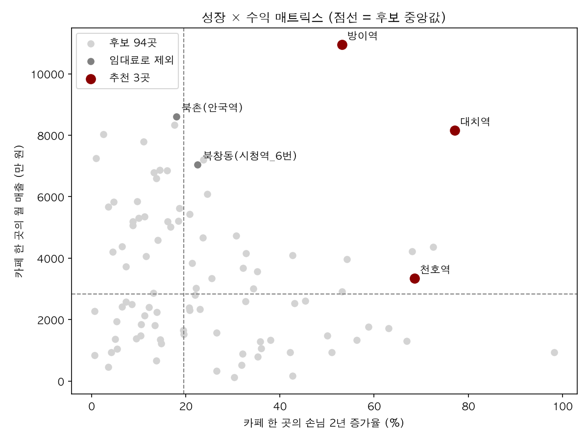
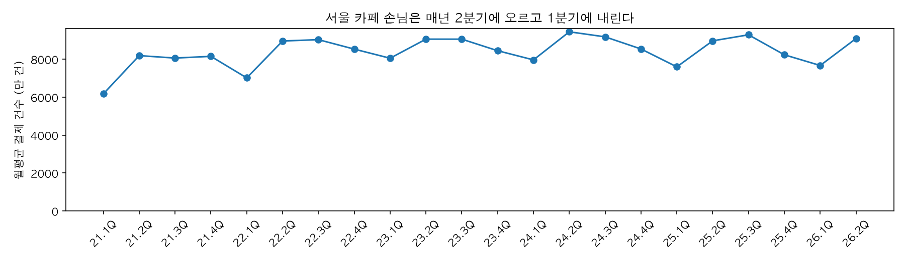
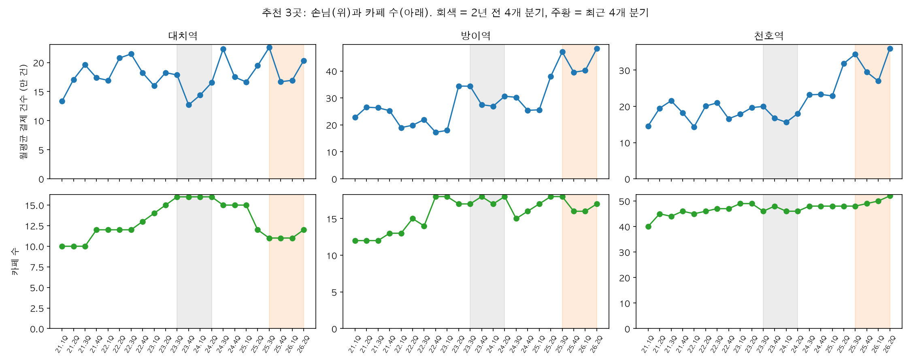

# 카페 2호점 입지 분석

서울에서 카페 1곳을 운영하는 소규모 브랜드(가상 클라이언트)에게 "2호점을 서울 어느 상권에 내야 하는가"를 답하는 컨설팅 프로젝트입니다. 문제 정의 → MECE 이슈 트리 → 가설 → 분석 → 피라미드 구조의 보고서 순서로 진행했고, 분석에는 서울시 상권분석서비스 공공데이터(2021년 1분기 ~ 2026년 2분기)와 한국부동산원 임대료를 썼습니다.

**기술**: Python(pandas, matplotlib) · PostgreSQL(CTE, `CASE WHEN`, 윈도 함수 `LAG`) · Jupyter
**프레임워크**: 문제 정의서(SMART) · MECE 이슈 트리 · 가설 중심 작업 계획 · 80/20 우선순위 · 2×2 매트릭스 · SCQA · 피라미드 원칙 · 액션 타이틀

📄 **최종 보고 덱**: [`reports/최종보고_카페2호점.pdf`](reports/최종보고_카페2호점.pdf)

## 결론

> **2호점은 대치역·방이역·천호역 중 한 곳이 적합하며, 계약 전 3개월 동안 임대료·폐점 사유·가격 경쟁을 확인해 1곳으로 좁혀야 합니다.**

| 상권 | 손님 2년 | 카페 수 2년 | 카페 한 곳의 손님 2년 | 카페 한 곳의 월 매출 | 임대료(서울 평균 대비) | 핵심 위험 |
|---|---|---|---|---|---|---|
| 대치역(강남구) | +24.5% | −29.7% | +77.1% | 8,153만 원 (94곳 중 4위) | 1.22배 | 몫 증가의 상당 부분이 폐점 효과 |
| 방이역(송파구) | +46.6% | −4.3% | +53.2% | 1억 946만 원 (1위) | 0.85배 | 객단가 −22.2%, 가격 경쟁 |
| 천호역(강동구) | +80.4% | +7.0% | +68.6% | 3,341만 원 (42위) | 1.09배 | 카페 한 곳의 매출이 낮음 |

다음 1년은 세 곳 모두 최근 1년 수준이 유지될 전망입니다(과거 오차 ±15 ~ 25%).

## 컨설팅 프로세스

| 단계 | 산출물 | 내용 |
|---|---|---|
| 1 문제 정의 | [00_문제정의서](docs/00_문제정의서.md) | SMART 질문, 의사결정자, 성공 기준, 범위, 제약 |
| 2 구조화 | [01_이슈트리](docs/01_이슈트리.md) | 시간(지금/앞으로) → 수요·경쟁·수익성(매출/비용)·지속성, MECE 점검, 80/20 우선순위 |
| 3 가설·작업 계획 | [02_가설_작업계획](docs/02_가설_작업계획.md) | 가설 H0~H5, 판정 규칙, 판정 결과, 사후에 바꾼 기준 |
| 4 분석 | `notebooks/01` ~ `04` | 섹션마다 가설 번호와 판정 |
| 5 종합 | [03_스토리라인](docs/03_스토리라인.md) | SCQA, 피라미드, 고스트 덱(액션 타이틀 흐름) |
| 6 보고 | `reports/` | 최종 보고 덱 26장 |

## 이슈 트리와 판정

| 갈래 | 가설 | 판정 |
|---|---|---|
| (배경) | H0 서울 카페 시장 전체는 성장하지 않는다 | 채택: 손님 −1.8%, 카페 수 정점 대비 −5.2% |
| A1 수요 | H1 시장이 정체해도 손님이 늘어난 상권이 있다 | 채택: 364곳 중 111곳 |
| A2 경쟁 | H2 그중 카페 한 곳의 손님도 늘어난 상권이 있다 | 채택: 94곳 |
| A3-1 매출 | H3 몫이 커진 상권 중 매출도 높은 곳이 있다 | 채택: 대치역·방이역 상위 4위 안 |
| A3-2 비용 | H4 상위 후보의 임대료는 서울 평균 1.5배 이하다 | 부분 채택: 5곳 중 3곳 통과 |
| B1 지속성 | H5 손님·매출은 다음 1년에도 유지된다 | 조건부 채택: 오차 ±15 ~ 25% |

## 분석 방법

1. **시장과 계절성 확인** (`01`): 서울 카페 손님은 2년째 정체이고, 매년 2분기에 +18% 안팎 오르고 1분기에 내립니다. 그래서 모든 비교는 **4개 분기 합계끼리** 합니다.
   
2. **SQL로 지표 계산** (`sql/02_추천지표.sql`): 최근 12개 분기 매출이 모두 공개된 992개 상권마다 손님·카페 수 2년 증가율, 카페 한 곳당 손님·매출, 객단가 변화, 한 분기 최대 변화(`LAG`)를 계산합니다.
3. **스크리닝** (`03`): 데이터 신뢰도·수요·경쟁 조건 5단계로 걸러 94곳을 남기고, 성장·손님·수익 점수(백분위 평균)로 순위를 매긴 뒤, 자치구마다 1곳·임대료 서울 평균 1.5배 이하 조건으로 3곳을 고릅니다.
4. **지속성 점검** (`04`): "작년 × (1 + 성장률)"과 "작년과 같음"을 과거 세 시점에서 시험했고, 6번 모두 더 정확했던 "작년과 같음"으로 예측합니다.

## 한계

- 매출이 공개되지 않은 400곳(카페 1~2개 상권 등)은 볼 수 없습니다.
- 추정매출은 추정치입니다. 데이터 단절 기준(1.5배)은 결과를 본 뒤 2배에서 조정했고, 2배로 하면 세 번째 추천이 천호역 대신 공릉역입니다.
- 대치역·방이역의 임대료는 권역 평균이고 권리금은 반영하지 않았습니다.
- 유동인구·고객층은 데이터가 없어 현장 조사 과제로 넘겼습니다.

## 구성

| 폴더 | 내용 |
|---|---|
| `docs/` | 컨설팅 문서 00~03, [지표 정의서](docs/지표_정의서.md), [설명 가이드](docs/설명_가이드.md)(면접 대비 Q&A), 그림 |
| `notebooks/` | 01 데이터 파악(H0) → 02 전처리·적재 → 03 시장 매력도 스크리닝(H1~H4) → 04 지속성 점검(H5) |
| `sql/` | 기본 키, 추천 지표 계산 |
| `src/` | 여러 노트북에서 함께 쓰는 함수(원자료 읽기, DB 연결, 그래프 설정) |
| `reports/` | 최종 보고 덱(pptx, pdf) |
| `data/raw/` | 원자료(용량이 커서 올리지 않음) |
| `data/processed/` | 추천·예측 결과(`추천_후보.csv`, `예측_*.csv`) |

## 실행

1. `pip install -r requirements.txt`
2. `data/raw`에 상권분석서비스 CSV(추정매출·점포 연도별 5개씩, 영역 1개)와 한국부동산원 소규모 상가 임대료 CSV를 둡니다.
3. PostgreSQL에 빈 DB를 만들고, 프로젝트 루트 `.env`에 접속 정보(`PGHOST`, `PGPORT`, `PGUSER`, `PGPASSWORD`, `PGDATABASE`)를 적습니다.
4. `notebooks/`의 01 → 04를 순서대로 실행합니다.

## 출처

- 서울 열린데이터광장, 「서울시 상권분석서비스」(추정매출-상권, 점포-상권, 영역-상권)
- 한국부동산원, 「상업용부동산 임대동향조사」 2026년 2분기, 지역별 임대료(소규모 상가)
