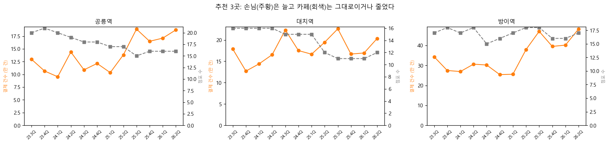
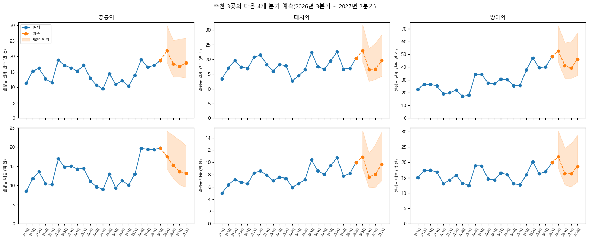
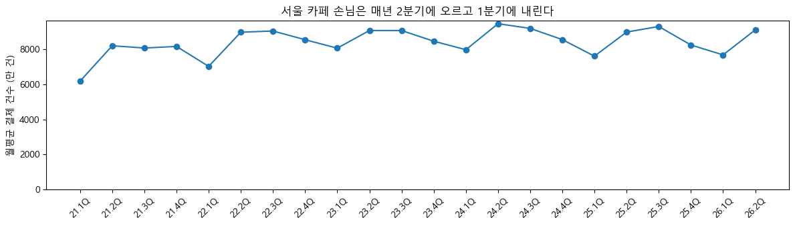

# 카페 2호점 입지 분석 프로젝트

서울시 상권분석서비스 공공데이터(2021년 1분기 ~ 2026년 2분기)로 "카페 2호점을 서울 어느 상권에 내야 하는가"에 답합니다. 손님이 2년 동안 꾸준히 늘었는지, 카페 한 곳이 받는 손님이 많은지, 임대료를 감당할 수 있는지를 보고 상권 3곳을 고릅니다. 이어서 그 3곳의 다음 1년 매출과 손님을 예측합니다.

**기술**: Python(pandas, scikit-learn, statsmodels, matplotlib) · PostgreSQL(CTE, 윈도 함수) · Jupyter

📄 **최종 보고 덱**: [`Google Drive Link`](https://drive.google.com/file/d/1WEL0MKA2sJos8YHkGlb53u34hwMyiLDU/view?usp=sharing)

## 결과

- 추천 3곳: **공릉역(노원구), 대치역(강남구), 방이역(송파구)**. 세 곳 모두 2년 사이 카페 손님은 25 ~ 50% 늘고 카페 수는 그대로이거나 줄어, 카페 한 곳이 받는 손님이 53 ~ 90% 늘었습니다.
- 다음 1년 예측: 손님은 세 곳 모두 지금 수준을 유지합니다. 매출은 대치역과 방이역이 지금 수준을 유지하고, 공릉역은 객단가가 되돌아갈 위험이 있습니다(−24%).

| 상권 | 손님 2년 | 카페 수 2년 | 카페 한 곳의 손님 2년 | 다음 1년 손님(예측) | 다음 1년 매출(예측) |
|---|---|---|---|---|---|
| 공릉역(노원구) | +49.8% | −21.2% | +90.2% | +4.0% | −23.8% |
| 대치역(강남구) | +24.6% | −29.7% | +77.1% | −1.0% | −1.1% |
| 방이역(송파구) | +46.6% | −4.3% | +53.2% | +2.2% | −0.3% |

## 분석 방법

1. **계절성부터 확인**: 서울 카페 손님은 매년 2분기에 +18% 안팎 오르고 1분기에 내립니다. 그래서 모든 비교는 4개 분기 합계끼리, 전년 같은 분기끼리 합니다.
   
2. **SQL로 추천 지표 계산** (`sql/02_추천지표.sql`): 최근 12개 분기 매출이 모두 공개된 992개 상권에서 2년 증가율, 전년 동기 상승 분기 수, 점포당 손님·매출, 상권 유형 안 백분위(`PERCENT_RANK`), 데이터 단절 표시(`LAG`)를 계산합니다.
3. **거르기와 순위** (`04_추천.ipynb`): 6단계로 거른 뒤 성장·손님 여력·수익성 점수로 순위를 매기고, 1km 일대로 묶어 중복을 없애고, 임대료를 확인합니다.
4. **예측** (`05_예측.ipynb`): 상권 하나에는 22개 분기밖에 없으므로 916개 상권을 함께 학습합니다. 목표는 전년 같은 분기 대비 로그 변화이고, 시점을 고정한 백테스트로 계절 단순 예측과 비교합니다. 전체 WAPE는 1~2%p 낮지만, 추천 3곳 개별 예측의 80% 범위는 −20% ~ +50%로 넓습니다.

## 한계

- 카페가 1~2개라 매출이 공개되지 않는 상권은 볼 수 없습니다.
- 추정매출은 카드 결제 등을 바탕으로 한 **추정치**입니다. 한 분기에 2배 넘게 뛰는 단절이 있는 상권은 뺐습니다.
- 추천 3곳 모두 1.5km 안에 부동산원 임대료 조사 상권이 없습니다. 실제 매물 임대료와 권리금은 따로 확인해야 합니다.
- 결과를 보고 추가한 규칙이 두 개 있습니다(데이터 단절 제외, 추천 3곳 사이 2km). 이유는 노트북과 지표 정의서에 적었습니다.

## 구성

| 폴더 | 내용 |
|---|---|
| `docs/` | [프로젝트 개요](docs/프로젝트_개요.md), [지표 정의서](docs/지표_정의서.md), 그림 |
| `notebooks/` | 01 데이터 파악 → 02 전처리 → 03 SQL 적재 → 04 추천 → 05 예측 |
| `src/` | 여러 노트북에서 함께 쓰는 함수(원자료 로드, DB 연결, 그래프 설정) |
| `sql/` | 기본 키, 추천 지표 계산(CTE, `CASE WHEN` 조건부 집계, `LAG`, `PERCENT_RANK`) |
| `data/raw/` | 원자료(용량이 커서 올리지 않음) |
| `data/processed/` | 추천·예측 결과(`추천_*.csv`, `예측_*.csv`). 전처리 중간 결과는 올리지 않음 |
| `reports/` | 최종 보고 덱 PDF |

## 실행

1. `pip install -r requirements.txt`
2. `data/raw`에 상권분석서비스 CSV(추정매출·점포 연도별 5개씩, 영역 1개)와 한국부동산원 소규모 상가 임대료 CSV를 둡니다.
3. 프로젝트 루트 `.env`에 PostgreSQL 접속 정보(`PGHOST`, `PGPORT`, `PGUSER`, `PGPASSWORD`, `PGDATABASE`)를 적습니다.
4. `notebooks/`의 01 → 05를 순서대로 실행합니다.

## 출처

- 서울 열린데이터광장, 「서울시 상권분석서비스」(추정매출-상권, 점포-상권, 영역-상권)
- 한국부동산원, 「상업용부동산 임대동향조사」 2026년 2분기, 지역별 임대료(소규모 상가)
