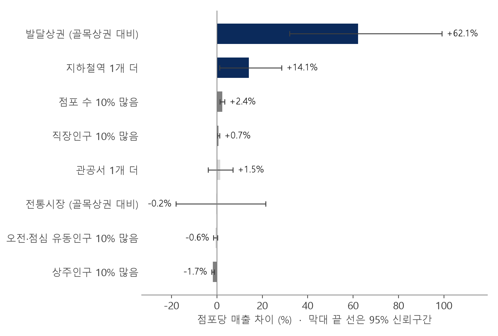
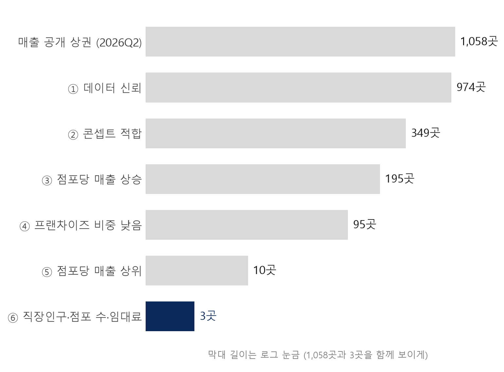
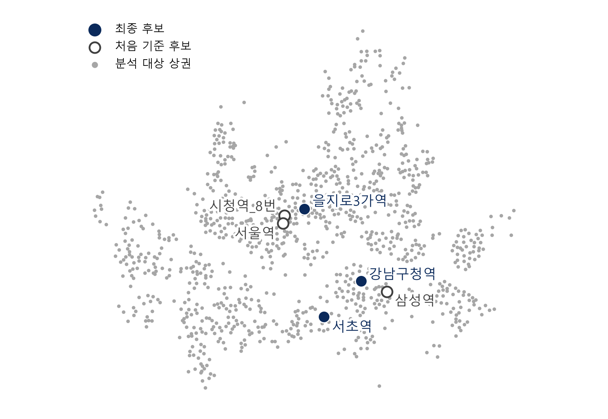

# 서울시 카페 2호점 입지 분석

서울에서 직장인 대상 테이크아웃 카페 1곳을 운영하는 소규모 브랜드가 2호점을 낸다면 어느 상권이 좋을지 공개 데이터로 분석한 프로젝트입니다. 서울시 상권분석서비스의 22개 분기(2021년 1분기~2026년 2분기) 데이터를 PostgreSQL에 넣고 SQL과 Python으로 가설을 검증한 뒤, 2026년 2분기 매출이 공개된 1,058개 상권 중에서 후보 3곳을 골랐습니다.

## 결론

직장인 수요가 크고 대형 프랜차이즈가 적은 상권 3곳을 2호점 후보로 제안합니다.

| 상권 | 강점 | 점포당 분기 매출 | 점포당 매출 추세 | 프랜차이즈 비중 | 직장인구 | 임대료 (서울 평균 대비) |
|---|---|---|---|---|---|---|
| 을지로3가역 | 매출 규모 | 6,861만 원 | +5.1% | 18.7% | 13,468명 | 1.30배 |
| 강남구청역 | 성장세 | 5,595만 원 | +10.7% | 17.1% | 15,763명 | 1.22배 |
| 서초역 | 임대료 | 4,982만 원 | +1.2% | 21.6% | 15,721명 | 0.88배 |

- 매출과 비중은 최근 4개 분기(2025년 3분기~2026년 2분기) 평균이고 추세는 직전 4개 분기와 비교한 값입니다.
- 세 곳 모두 점포당 매출이 서울 중앙값(최근 4분기 평균 1,519만 원)의 3.3~4.5배입니다.
- 데이터에는 매장별 매출이 없어서 새 매장이 실제로 가져갈 몫은 확인하지 못했습니다. 최종 1곳은 현장 조사와 임대 매물 확인을 거쳐 정해야 합니다.

보고서: [PDF](reports/카페2호점_입지분석.pdf) · [PPT](reports/카페2호점_입지분석.pptx) (14장)

## 문제 정의

| 항목 | 내용 |
|---|---|
| 의뢰인 | 서울에서 직장인 대상 테이크아웃 카페 1곳을 운영하는 소규모 브랜드 |
| 질문 | 2호점을 어느 상권에 내면 좋을까? |
| 핵심 지표 | 점포당 매출 = 상권의 커피 매출 ÷ 커피 점포 수 (새 매장이 평균적으로 가져갈 몫) |
| 콘셉트 적합도 | 오전·점심(06~14시) 매출 비중, 주중 매출 비중 |
| 점검 지표 | 매출 추세, 폐업률, 임대료 |
| 분석 대상 | 2026년 2분기 매출이 공개된 상권 1,058곳 (관광특구 제외) |

좋은 상권인지를 수요, 경쟁, 비용, 지속성 네 축으로 나누고 축마다 가설을 세웠습니다. 판정 기준은 데이터를 보기 전에 정했습니다.

## 가설 검증 결과

| 가설 | 내용 | 방법 | 결과 | 판정 |
|---|---|---|---|---|
| H1 | 직장인구가 많은 상권일수록 점포당 매출이 높음 | 상관, 회귀 | r = 0.37, 회귀 계수 유의 | 지지 |
| H2 | 06~14시 유동인구가 전체 유동인구보다 매출을 더 잘 설명함 | 상관 비교 | 두 r 모두 0에 가까움 | 기준 충족, 실질 의미 없음 |
| H3 | 지하철역·관공서가 있는 상권은 점포당 매출이 높음 | t-test, 회귀 | 지하철역 +152%, 관공서 +35% | 지지 |
| H4 | 카페가 많을수록 점포당 매출은 낮아짐 | 회귀 | 계수 +0.25 (반대 방향) | 기각 |
| H5 | 2년 전 순위가 높았던 상권은 지금도 순위가 높음 | 스피어만 | ρ = 0.91 | 지지 |
| H6 | 폐업률이 높으면 다음 해 성장률이 낮음 | 상관 | r = -0.07, 다른 연도·처리에서 유지 안 됨 | 기준 충족, 결과 불안정 |

모든 가설은 세 가지로 돌려서 결과가 처리 방법에 따라 바뀌는지 확인했습니다(기본, 결제가 거의 안 잡히는 상권 포함, 극단값 상권 제외). H6은 기본 결과만 보면 지지였지만 이 확인에서 결론이 흔들려서 후보를 거르는 기준으로 쓰지 않았습니다.



다른 조건이 같을 때 발달상권은 골목상권보다 점포당 매출이 약 60% 높고(95% 신뢰구간 32~99%) 지하철역이 하나 더 있으면 약 14% 높습니다(1~29%). 신뢰구간이 넓어서 크기는 대략적으로 봐야 합니다. 카페가 많은 상권의 점포당 매출도 더 높게 나왔는데(H4 기각) 한 시점의 상권끼리 비교한 결과라서 인과로 해석하지는 않았습니다.

## 후보 선정



| 순서 | 기준 | 근거 |
|---|---|---|
| ① 데이터 신뢰 | 최근 4개 분기 모두 매출이 있고 점포당 결제가 하루 1건 이상 | 데이터 점검 |
| ② 콘셉트 적합 | 오전·점심 비중, 주중 비중이 둘 다 서울 중앙값 이상 | 직장인 테이크아웃 콘셉트 |
| ③ 추세 | 최근 4분기 점포당 매출이 직전 4분기보다 상승 | H5 |
| ④ 경쟁 | 프랜차이즈 비중이 서울 중앙값(21.8%)보다 낮음 | 대형 프랜차이즈와의 정면 경쟁 회피 |
| ⑤ 순위 | 최근 4분기 점포당 매출 상위 10곳 | H5 |
| ⑥ 검토 | 직장인구 1만 명 이상, 점포 10개 이상, 임대료 서울 평균 2배 미만 | H1, 새 매장이 들어갈 때의 영향 |

③과 ④는 처음 상위 10곳을 본 뒤에 바꾼 기준입니다. 처음 기준으로는 시청역_8번, 삼성역, 서울역이 뽑혔는데 세 곳 모두 프랜차이즈 비중이 서울 중앙값의 1.5~2배였습니다. 서울역은 2년 사이 카페가 13% 줄면서 상권 전체 매출도 12% 줄고 있었는데 점포당 매출만 보면 드러나지 않았습니다. 바꾼 이유와 바꾸기 전 결과는 결정 기록에 남겼습니다.



최종 후보는 처음 후보와 같은 도심·강남 권역에 있습니다. 을지로3가역은 시청역_8번에서 1.6km, 강남구청역은 삼성역에서 2.2km 떨어져 있습니다. 오피스가 모인 권역은 그대로 두고 그 안에서 대형 프랜차이즈가 적은 상권으로 옮긴 셈입니다.

## 데이터

| 데이터 | 출처 | 내용 |
|---|---|---|
| 추정매출-상권 | 서울 열린데이터광장, 서울시 상권분석서비스 | 상권·업종·분기별 카드 매출 추정치 (시간대, 요일 포함) |
| 점포-상권 | 같은 곳 | 상권·업종별 점포 수, 프랜차이즈 점포 수, 폐업률 |
| 길단위인구-상권 | 같은 곳 | 시간대별 유동인구 |
| 직장인구-상권, 상주인구-상권 | 같은 곳 | 상권별 직장인구, 상주인구 |
| 집객시설-상권 | 같은 곳 | 지하철역, 관공서 등 시설 수 |
| 영역-상권 | 같은 곳 | 상권 이름, 유형(골목·발달·전통시장·관광특구), 자치구 |
| 임대동향 지역별 임대료 | 한국부동산원 R-ONE | 2026년 2분기 소규모 상가 ㎡당 임대료 |

원자료는 용량 때문에 저장소에 올리지 않았습니다. 위 데이터를 내려받아 `data/raw/`에 넣으면 됩니다. 추정매출과 점포 데이터는 연도별 파일(2021~2024년, 2025~2026년)로 나뉘어 있습니다.

## 데이터 문제와 처리

원자료에서 발견한 문제 13건을 원인, 확인 근거, 처리, 결과 영향으로 기록했습니다. 아래는 그중 결과에 영향이 큰 것들입니다.

| 문제 | 확인 | 처리 |
|---|---|---|
| 2025년부터 점포 수 컬럼 구성이 바뀜 | 옛 컬럼과 새 컬럼이 같은 식(일반 + 프랜차이즈)인지 전부 확인, 안 맞는 행 0개 | 하나로 통일 (그대로 이었으면 점포 5,315개가 한 분기 만에 늘어난 것처럼 보임) |
| 점포가 적은 상권은 매출이 없음 | 점포 수별 공개 비율 (0~2개 0%, 3개 63.8%, 6개 이상 95.1%) | 채우지 않고 결측 유지 |
| 점포당 분기 매출이 100만 원도 안 되는 상권 | 객단가는 보통인데 결제 건수가 다른 상권의 40분의 1 | 점포당 결제 하루 1건 미만인 줄은 분기마다 제외 |
| 점포당 매출이 2위의 두 배인 상권(시청역_8번) | 22개 분기 내내 서울 중앙값의 18~28배, 오피스 상권 모습과 맞음 | 진짜 값으로 보고 유지, 뺀 결과도 확인 |
| 역 이름 상권인데 지하철역 수가 0 | 역 이름 상권 396곳 중 62%가 0 | 이름까지 보는 역세권 표시로 보완 |
| 폐업률 절반 이상이 0%, 120% 값도 있음 | 점포가 적은 상권은 한 곳만 닫아도 크게 뜀 | 후보를 거르는 기준에서 제외 |

## 한계

- 매출은 카드 결제 기반 추정치입니다.
- 매장별 매출과 브랜드 점유율이 없어서 새 매장이 가져갈 몫은 숫자로 확인하지 못했습니다.
- 임대료는 R-ONE 지역과 상권을 손으로 맞췄고 상위 10곳 중 6곳은 권역 평균을 썼습니다.
- 회귀의 R²는 0.26으로 매장 위치나 브랜드처럼 데이터에 없는 요인의 영향이 큽니다.

## 폴더 구조

```
├── data/raw/                  원자료 CSV (저장소에는 없음)
├── sql/
│   ├── 01_분석_테이블.sql      커피 업종 추출, 점포 수 통일, 데이터 결합, 성장률(LAG)
│   ├── 02_분석_대상.sql        제외 표시와 로그 값을 붙인 뷰
│   └── 03_후보_선정.sql        최근·이전 4분기 요약, 기준별 통과 표시, 순위(RANK)
├── notebooks/
│   ├── 01_데이터_적재.ipynb     원자료 점검, PostgreSQL 적재
│   ├── 02_전처리_검증.ipynb     분석 테이블 생성, 정제 규칙 확인
│   ├── 03_이상치_점검.ipynb     저매출 상권과 극단값의 원인 확인
│   ├── 04_수요_경쟁_가설.ipynb  H1~H4
│   ├── 05_지속성_가설.ipynb     H5, H6
│   ├── 06_후보_선정.ipynb       후보 선정, 임대료 매칭
│   └── 07_보고서_차트.ipynb     보고서 차트와 장표 숫자
├── reports/
│   ├── 카페2호점_입지분석.pdf   보고서 (PDF)
│   ├── 카페2호점_입지분석.pptx  보고서 (PowerPoint)
│   ├── deck_spec.json          보고서 장표 내용
│   └── figures/                보고서 차트
└── requirements.txt
```

## 실행 방법

1. 패키지를 설치합니다.

   ```bash
   pip install -r requirements.txt
   ```

2. PostgreSQL에 데이터베이스를 하나 만들고 접속 정보를 저장소 맨 위 `.env` 파일에 적습니다.

   ```
   PGHOST=localhost
   PGPORT=5432
   PGUSER=사용자
   PGPASSWORD=비밀번호
   PGDATABASE=데이터베이스_이름
   ```

3. 원자료 CSV를 `data/raw/`에 넣습니다.
4. 노트북을 01부터 07까지 순서대로 실행합니다. 01은 원본 테이블을 적재하느라 몇 분 걸립니다. 05와 06은 04가 만든 뷰를, 07은 06이 만든 테이블을 씁니다.

보고서 장표는 `reports/deck_spec.json`을 개인 슬라이드 제작 도구로 빌드해서 만들었습니다. 차트는 07 노트북에서 그린 이미지입니다.

## 사용 기술

| 구분 | 내용 |
|---|---|
| 데이터베이스 | PostgreSQL (CTE, 윈도 함수 LAG·RANK, PERCENTILE_CONT, 뷰) |
| 분석 | Python, pandas, scipy(상관·t-test·스피어만), statsmodels(다중회귀) |
| 시각화 | matplotlib |
| 환경 | Jupyter, SQLAlchemy, python-dotenv |
