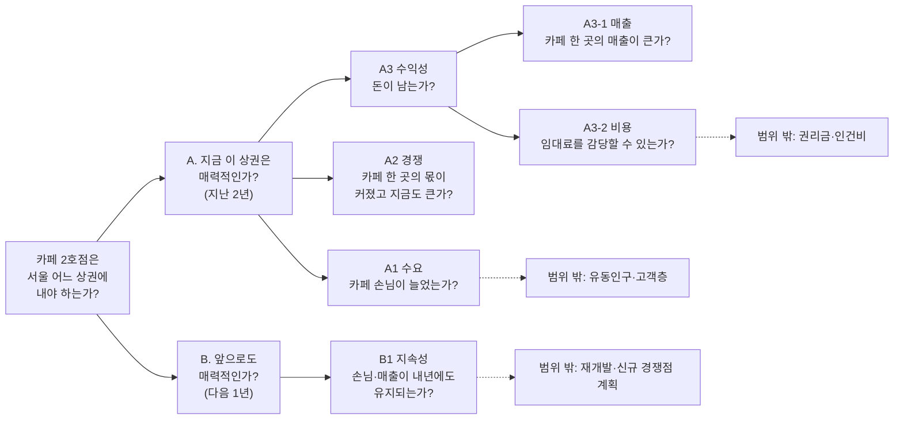

# 01. 이슈 트리 (Issue Tree)

핵심 질문을 **겹치지 않고(Mutually Exclusive) 빠짐없이(Collectively Exhaustive)** 작은 질문으로 나눕니다(MECE). 각 끝 질문은 데이터로 답할 수 있어야 합니다.

## 1. 트리

## 2. MECE 점검

| 단계 | 나누는 기준 | 겹치지 않는가 (ME) | 빠짐없는가 (CE) |
|---|---|---|---|
| 핵심 질문 → A, B | **시간**: 지난 2년 / 다음 1년 | 같은 기간을 두 번 보지 않음 | 과거와 미래를 모두 다룸 |
| A → A1, A2, A3 | **수요 / 공급 / 돈** | A1은 손님 전체, A2는 손님 ÷ 카페 수, A3는 금액으로 서로 다른 양을 봄 | 상권 매력도를 이루는 세 요소(손님이 있는가, 내 몫이 있는가, 돈이 되는가) |
| A3 → A3-1, A3-2 | **수입 / 비용** | 매출과 임대료는 서로 다른 데이터 | 이익 = 수입 − 비용의 두 항 |

- A1과 A2가 정말 다른 것을 거르는지 데이터로 확인했습니다. 손님은 줄었는데 카페 한 곳의 손님은 늘어난 상권이 148곳, 반대인 상권이 41곳입니다(`03` 2절). 하나만 쓰면 이 상권들이 걸러지지 않습니다.
- 분석 대상도 MECE로 나눴습니다. 서울 1,650개 상권 = 카페 없음 104 + 매출 비공개 400 + 일부만 공개 154 + **분석 대상 992**(`01` 5절).

## 3. 우선순위 (80/20)

"결정에 미치는 영향"과 "공개 데이터로 답할 수 있는가"로 갈래마다 분석 여부를 정했습니다.

| 갈래 | 결정에 미치는 영향 | 데이터로 답할 수 있는가 | 처리 |
|---|---|---|---|
| A1 수요 | 높음 | 예 (결제 건수) | 분석 |
| A2 경쟁 | 높음 | 예 (건수 ÷ 점포 수) | 분석 |
| A3-1 매출 | 높음 | 예 (매출 금액) | 분석 |
| A3-2 비용 | 높음 | 일부 (조사 상권·권역 수준 임대료) | 분석 + 현장 확인 |
| B1 지속성 | 중간 | 일부 (단순 예측, 오차 큼) | 분석 (방향만 사용) |
| 유동인구·고객층 | 중간 | 아니오 | 범위 밖 → 권고 2 (현장 조사) |
| 권리금·인건비 | 중간 | 아니오 | 범위 밖 → 권고 1 (시세 조사) |
| 재개발·경쟁점 계획 | 낮음~중간 | 아니오 | 범위 밖 → 한계에 기록 |

범위 밖 갈래도 트리에서 지우지 않고 남겨 둡니다. "빠짐없이 생각했지만 이 데이터로는 답할 수 없는 부분"을 보고서의 한계와 권고로 넘기기 위해서입니다.

## 4. 갈래 → 가설 → 분석

갈래마다 가설 하나를 세웠습니다. 자세한 내용은 [02_가설_작업계획.md](02_가설_작업계획.md)에 있습니다.

| 갈래 | 가설 | 노트북 |
|---|---|---|
| (배경) | H0 서울 카페 시장 전체는 성장하지 않는다 | `01` 4절 |
| A1 수요 | H1 시장이 정체해도 손님이 늘어난 상권이 있다 | `03` 2절 |
| A2 경쟁 | H2 그중 카페 한 곳의 손님도 늘어난 상권이 있다 | `03` 2~3절 |
| A3-1 매출 | H3 몫이 커진 상권 중 카페 한 곳의 매출도 높은 곳이 있다 | `03` 3절 |
| A3-2 비용 | H4 상위 후보의 임대료는 서울 평균의 1.5배 이하다 | `03` 4절 |
| B1 지속성 | H5 추천 상권의 손님·매출은 다음 1년에도 유지된다 | `04` |
